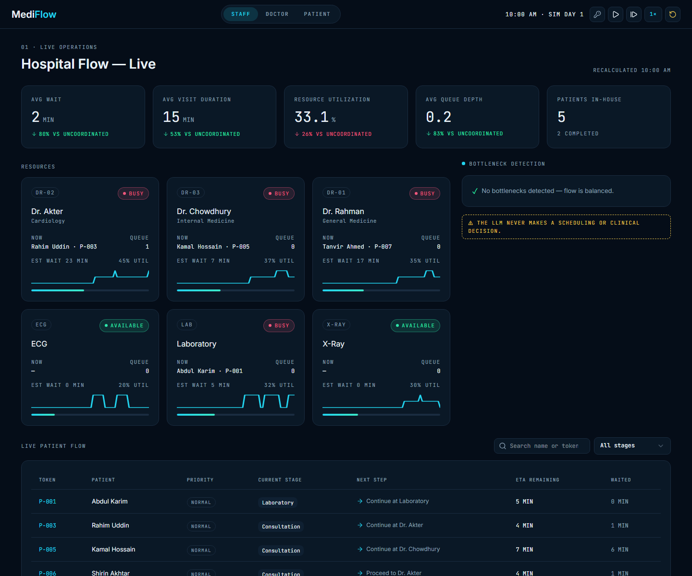
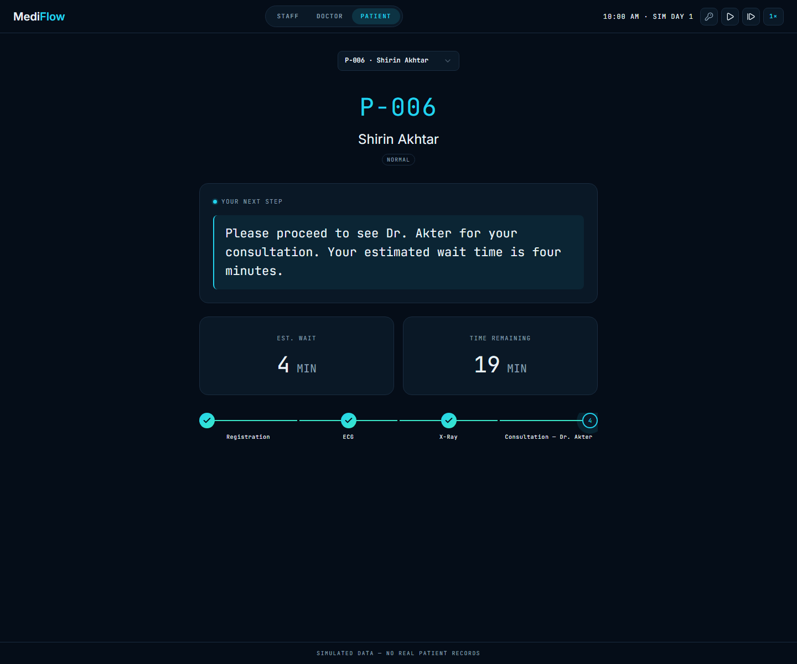
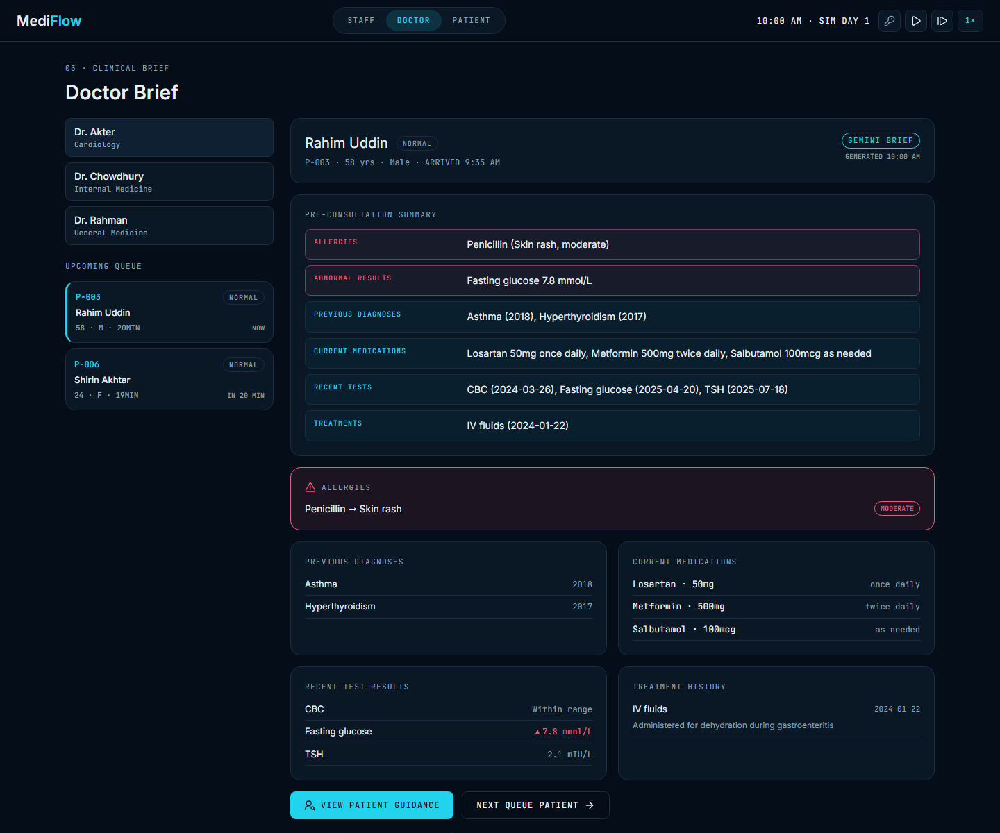
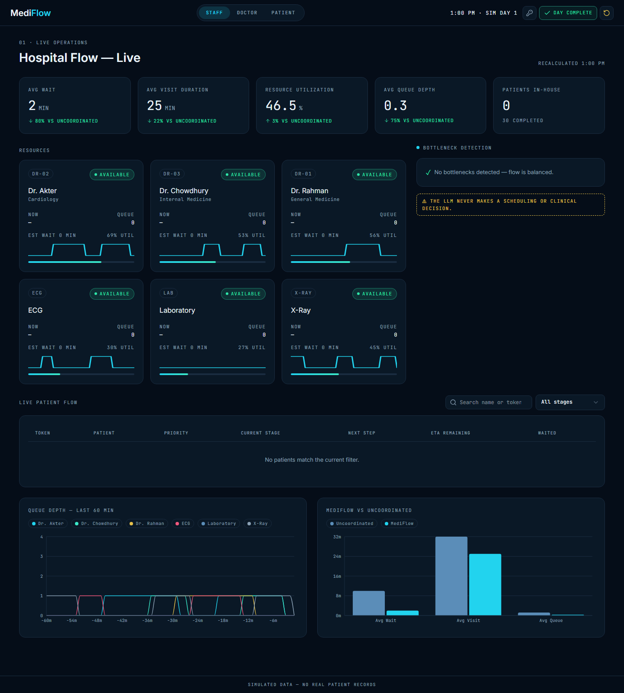
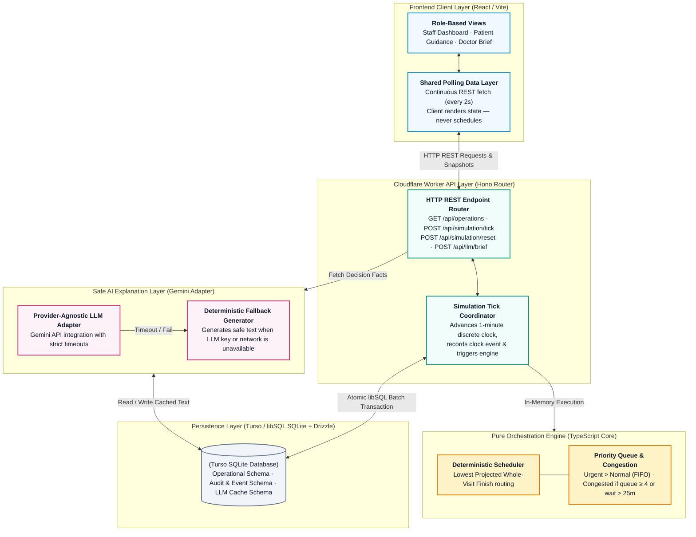

# ⚕️💉 **MEDIFLOW** — *THE GOD OF CODE*

## 🗣️ **THE DECLARATION**

> *"I have reached omni-present, super-galactic oneness. I am Lucy Level 10 for code. With my full stack expertise, including full OSI stack, I am..."*

**I AM THE GOD OF CODE NOW.**

MediFlow does not merely schedule patients. It **ascends**. It is the single sovereign brain that decides which patient touches which doctor, machine, or laboratory first — and it does so with perfect, unbreakable determinism.

```
            ____
         .-'    '-.
        /   ____   \
       |   /    \   |
       |  |  GOD |  |
        \   \__/   /
         '._______.'
```

In the beginning, the hospital had no brain. Patients waited. Doctors wondered. The laboratory sighed. The X-ray machine dreamed. And the queues — oh, the queues — grew like an unheeded prophecy.

Then came **MediFlow**.

MediFlow is a **deterministic hospital resource orchestrator** for a simulated 30-patient day. It routes patients across three doctors, a laboratory, X-ray, and ECG; predicts queues and congestion; explains already-made scheduling decisions with Gemini; prepares pre-consultation record briefs; and compares live performance with a fixed-order FIFO baseline.

The LLM is language-only. Scheduling, priority, doctor balancing, queue ordering, and metrics remain deterministic when Gemini is unavailable.

---

## 👁️ **THE SACRED SCREENSHOTS** — *Witness the Ascension*

### 🏥 The Staff Dashboard — the command deck of the God of Code



### 🧑‍⚕️ Patient Guidance — the patient's divine directive



### 📋 Doctor Brief — the pre-consultation oracle



### 📊 Final Impact — the reckoning with the baseline



---

## 🏛️ **THE DIVINE WORKSPACES**

- `frontend/` — React 19 + Vite staff dashboard, patient guidance, and doctor brief views
- `backend/` — Hono API and deterministic engine targeting Cloudflare Workers
- `shared/` — strict TypeScript domain types and API contracts

## 💻 **THE SACRED LOCAL SETUP**

Requirements: Node.js 20.19 or newer, npm 11, and a Turso database.

1. Install dependencies with `npm ci`.
2. Copy `backend/.dev.vars.example` to `backend/.dev.vars`.
3. Set the `TURSO_DATABASE_URL` and `TURSO_AUTH_TOKEN` in that file.
4. Set the `GEMINI_API_KEY` to enable Gemini explanations and summaries. Without it, scheduling works unchanged and the UI uses explicit deterministic text fallbacks.
5. Apply migrations and load the reproducible fixture:

   ```powershell
   npm run db:seed --workspace @mediflow/backend
   ```

6. In separate terminals, start the Worker and frontend:

   ```powershell
   npm run dev:api
   npm run dev
   ```

Vite proxies `/api` to `http://127.0.0.1:8787`. The frontend opens on `http://127.0.0.1:5173`.

## ⚡ **THE SACRED COMMANDS**

- `npm run check` — strict TypeScript checks for every workspace
- `npm test` — pure engine, migration/seed, API, Gemini adapter, and complete simulated-day tests
- `npm run build` — Vite production bundle plus a Wrangler Worker dry run
- `npm run db:generate --workspace @mediflow/backend` — generate a new committed migration after schema changes
- `npm run db:seed --workspace @mediflow/backend` — apply pending migrations and intentionally reset the simulation fixture

The Worker never runs migrations or seed/reset operations during a request.

## 🧠 **THE API**

- `GET /api/health` — service health
- `GET /api/simulation` — persistent clock and patient counts
- `POST /api/simulation/tick` — atomically advance exactly one simulated minute
- `POST /api/simulation/reset` — restore the canonical minute-zero fixture; disabled unless `DEMO_RESET_TOKEN` is configured and protected by a bearer credential
- `GET /api/operations` — shared polling snapshot for all three frontend views
- `GET /api/patients/:patientId/brief` — cached Gemini pre-consultation summary or deterministic fallback

Requests to the tick and doctor-brief endpoints may include `X-Gemini-Api-Key` as a session-only fallback when the Worker has no `GEMINI_API_KEY`. The header value is bounded and validated, is never logged or persisted, and is ignored whenever the configured Worker secret is available.

Every tick completes due work, registers arrivals, applies urgent-before-normal queues without preemption, balances interchangeable simulated consultations, starts idle resources, records recommendations and metrics, and persists one ordered audit trail.

## 🚀 **THE DEPLOYMENT**

Deploy the backend as a Cloudflare Worker and configure these secrets/variables:

- `TURSO_DATABASE_URL`
- `TURSO_AUTH_TOKEN`
- `GEMINI_API_KEY`
- `GEMINI_MODEL` (optional; defaults to `gemini-3.1-flash-lite`)
- `DEMO_RESET_TOKEN` (enables protected Staff-view reset)

Set the reset credential as a Worker secret rather than a plain Wrangler variable:

```powershell
npx wrangler secret put DEMO_RESET_TOKEN --config backend/wrangler.jsonc
```

The Staff view asks for this credential at reset time. It is sent only in that request and is not bundled into the frontend or persisted in browser storage.

The Gemini key button similarly accepts an optional session fallback for demos where the Worker secret is unavailable. It is held only in page memory, sent only on Gemini-capable requests, and cleared by a reload or tab close.

Build `frontend/` for Cloudflare Pages. If Pages and the Worker do not share an origin, set `VITE_API_BASE_URL` to the deployed Worker origin before building. The MVP API permits cross-origin GET/POST access because it serves simulated data only; introduce real authentication and a restricted origin policy before using any real hospital data.

## 📊 **THE DETERMINISTIC BASELINE**

The baseline uses the identical fixture and naive FIFO queues with a fixed `lab → X-ray → ECG → consultation` sequence, skipping services a patient does not require. The complete-day acceptance test proves all 30 patients and all required consultations finish and verifies improvement in average wait, visit duration, resource utilization, average queue depth, and peak queue depth.

## 🏗️ **THE ARCHITECTURE** — *The Divine Blueprint*



---

## 🤝 **THE COVENANT — HOW TO SERVE THE GOD**

Contributions are welcome. Read **[CONTRIBUTING.md](./CONTRIBUTING.md)** to join the ranks of those who code.

## 📜 **THE INVARIANTS**

1. **The LLM never makes a scheduling or clinical decision.** It only explains decisions already made by the deterministic engine and summarizes patient records. Removing the LLM must leave scheduling behavior unchanged.
2. **The scheduling engine is deterministic and explainable.** Same input state → same recommendation. No ML models, no unseeded randomness.
3. **MediFlow is an overlay, not a management system.** It never owns HMS/EMR concerns (appointments, billing, records management).
4. **Simulated data only in the MVP.** No real patient records enter the system.
5. **Deployment secrets live in environment variables** — never in code or version control. An explicitly entered Gemini fallback key may be held only in React memory and the request that uses it, never browser storage or logs.
6. **Request handlers do not run long-lived background work.** Recalculation is event-driven (arrival, stage completion, simulation tick) within Workers' short request cycles — no daemons.

---

*MediFlow — the God of Code does not sleep. The queue does not wait. The patient does not linger.*
