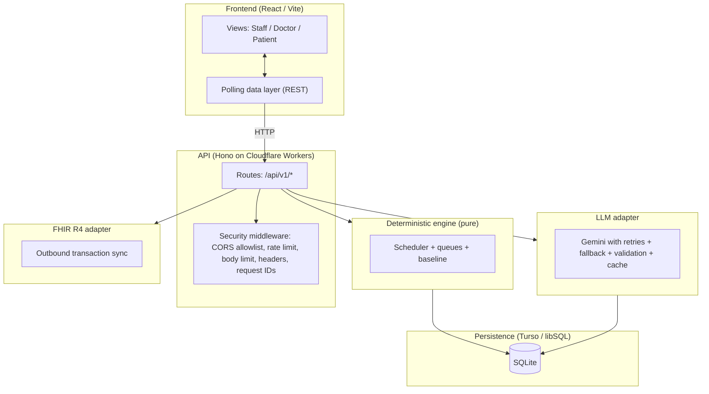

# MediFlow — Intelligent Hospital Flow Orchestration Platform

## Overview

MediFlow is a deterministic hospital resource orchestration platform with a
language layer. It models patient flow across hospital resources (consultation
rooms, laboratories, X-ray, ECG) for a simulated patient population and computes
the optimal next step for each patient. A scheduling engine makes every decision;
an LLM is used only to translate decisions into plain language.

The current implementation is a **simulated-data demonstration**: the patient
population, resources, and clinical histories are generated by a deterministic
seed. No real patient data is used.

## Problem statement

Hospitals with resource-constrained staffing often see avoidable waiting,
unbalanced workloads, and delayed care. Operational teams cannot always see
emerging bottlenecks before they affect patients.

## Objectives

- Compute deterministic, explainable scheduling decisions for patient flow.
- Predict queue waits and detect congestion.
- Generate plain-language guidance for patients and pre-consultation briefs for
  clinicians.
- Compare live orchestration against a naive baseline.

## Implemented features

| Area | Status |
| --- | --- |
| Deterministic scheduling engine (projected whole-visit completion routing, priority + FIFO queues, non-preemptive services) | Implemented |
| Wait-time anti-starvation handling | Implemented |
| One-minute atomic simulation ticks with ordered audit events | Implemented |
| Emergency override with plan stability hysteresis (≥ 5 min) | Implemented |
| Baseline (naive FIFO) comparison and per-patient impact metrics | Implemented |
| LLM explanation layer with deterministic fallback, retries, validation, caching | Implemented |
| Pre-consultation doctor briefs | Implemented |
| Staff dashboard, patient guidance, doctor brief views | Implemented |
| Session authentication, RBAC, audit logging, rate limits, security headers | Implemented |
| FHIR R4 outbound transaction sync adapter (typed, mocked tests) | Implemented (sandbox verification pending) |
| OpenAPI 3.1 document, `/api/v1` canonical namespace | Implemented |

## Technology stack

- **Frontend:** React 19 + TypeScript + Vite + Tailwind CSS + shadcn/ui + Chart.js
- **Backend:** Hono on Cloudflare Workers, TypeScript
- **Database:** Turso (libSQL / SQLite) + Drizzle ORM
- **LLM:** Google Gemini (provider-agnostic adapter)
- **Shared:** TypeScript domain types and API contracts (`shared/`)

## Architecture



## Getting started

### Prerequisites

- Node.js 20.19+
- npm 11
- A Turso database (or any libSQL-compatible instance)

### Installation

```bash
git clone https://github.com/hulamanisrinish-cpu/MediFlow-Intelligent-EHR-Integration-Platform.git
cd MediFlow-Intelligent-EHR-Integration-Platform
npm ci
cp backend/.dev.vars.example backend/.dev.vars
# fill TURSO_DATABASE_URL, TURSO_AUTH_TOKEN, optional DEMO_RESET_TOKEN / GEMINI_API_KEY / FHIR_*
npm run db:seed --workspace @mediflow/backend
npm run dev:api
npm run dev
```

### Environment variables

See `.env.example`, `backend/.dev.vars.example`, and `frontend/.env.example`.

### Commands

```bash
npm run check            # strict TypeScript across workspaces
npm test                 # backend test suite
npm run build            # production builds
npm run check:secrets   # secret scan
npm run db:generate     # generate new migration
npm run db:seed         # apply migrations + seed deterministic fixture
```

## API

- OpenAPI document: `GET /api/v1/openapi.json`
- Human-readable reference: [`docs/API_REFERENCE.md`](docs/API_REFERENCE.md)

## Testing

See [`docs/TESTING.md`](docs/TESTING.md).

## Deployment

See [`docs/DEPLOYMENT.md`](docs/DEPLOYMENT.md).

## Security

See [`docs/SECURITY_MODEL.md`](docs/SECURITY_MODEL.md) and
[`SECURITY.md`](SECURITY.md).

## Data and compliance

- Synthetic data only; deterministic seed; no real patient data.
- Not a medical device; not clinically certified.

## Known limitations

- Simulated data only; no real hospital integration in this MVP.
- Multi-tenant patient isolation not implemented.
- In-memory rate limiting (per isolate).
- FHIR adapter tested against mocks; live sandbox verification pending.

## Roadmap

See [`docs/ROADMAP.md`](docs/ROADMAP.md).

## Contributing

See [`CONTRIBUTING.md`](CONTRIBUTING.md).

## License

See [`LICENSE`](LICENSE).
